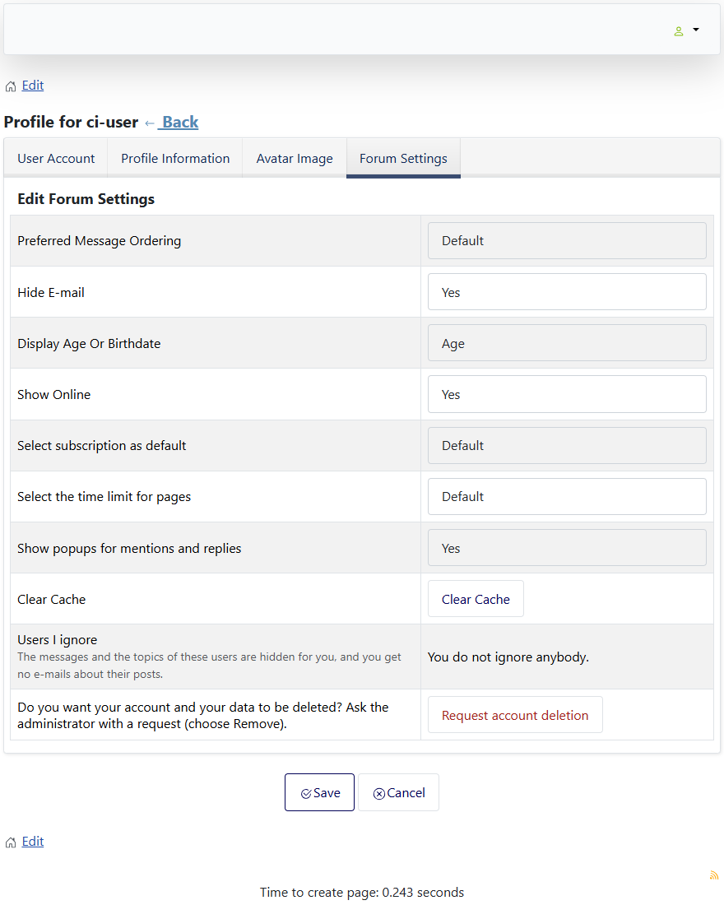

# Delete a user in Joomla and request the deletion of an account

> **Label:** `feature` · **Since:** Kunena 7.2 · **For:** Administrators, users

Links to delete a user in Joomla, and a button to ask for the removal of the own account.

- **Backend:** the toolbar of the Kunena user form has **Delete user in Joomla**, which opens the Joomla user list filtered on this user
  (Joomla asks for its own confirmation).
- **Frontend:** an administrator who edits another user gets the same button. Every user gets **Request account deletion** on the forum
  settings tab of his own profile.

The request opens the privacy request form of Joomla (`com_privacy`), so an administrator handles the removal.

---

[← All the new features of Kunena 7.2](../README.md)
