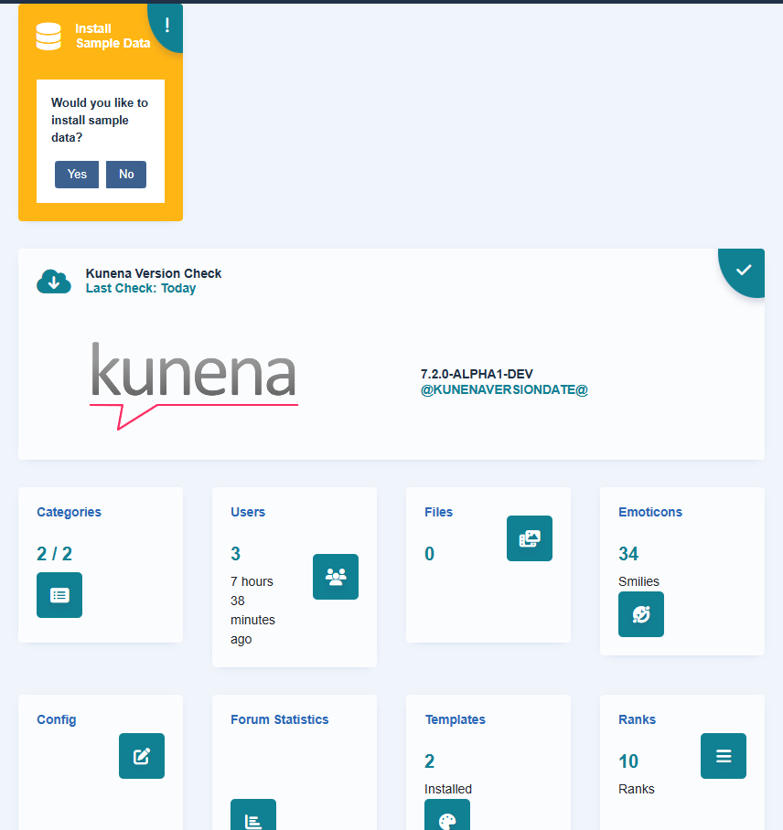

# Backend: menu icons, order of the views and update check

> **Label:** `feature` · **Since:** Kunena 7.2 · **For:** Administrators

A cleaner administration: icons in the menu, the views in alphabetical order and a real update check.

- The menu of the Kunena views in the menu on the left is in **alphabetical order** (the Dashboard first) and has an **icon** before each
  view.
- The dashboard shows the **real time of the last update check** of Kunena, and an update icon on the version card when an update is
  available.
- The administration uses Bootstrap 5 markup everywhere (forms, buttons, alerts) and is readable in the dark template of Joomla.

---

[← All the new features of Kunena 7.2](../README.md)
