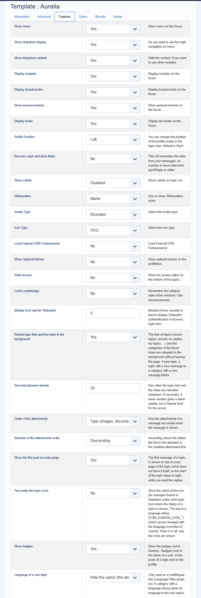

# Topic lists and index reload in the background

> **Label:** `feature` · **Since:** Kunena 7.2 · **For:** Users

The lists of topics and the forum index update by themselves, and new items blink.

The lists of topics (recent topics, unread, no replies, my topics, moderator) and the categories of the index are fetched again in the
background, and only the changed rows are replaced. A new topic, a topic with a new message or a category with a new message blinks; the
relative times of the other rows move on. Nothing happens while the tab is hidden or while a row is checked.

## Options (Aurelia template)

| Option | Where | Default |
| --- | --- | --- |
| Reload topic lists and the index in the background | Kunena, Templates, Aurelia, tab *Features* | Yes |
| Seconds between reloads (minimum 10) | same tab | 30 |

---

[← All the new features of Kunena 7.2](../README.md)
