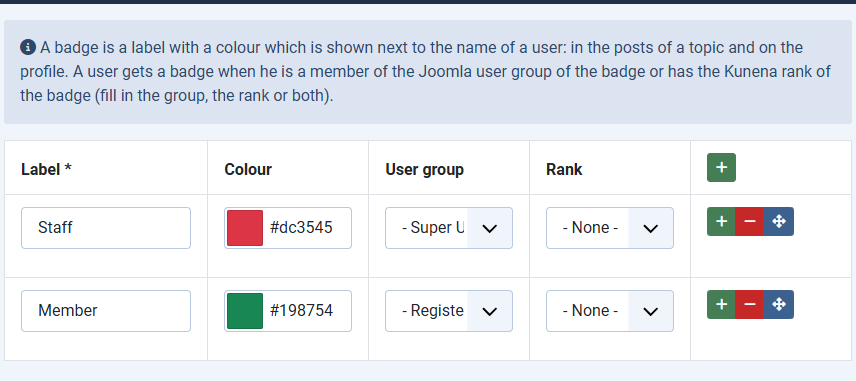
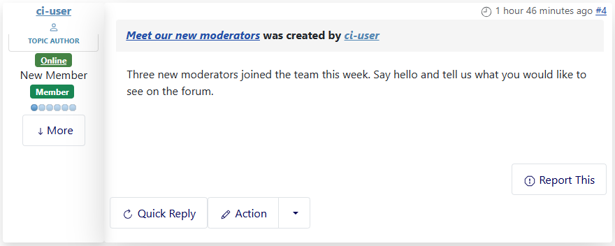

# Badges for user groups and ranks

> **Label:** `feature` · **Since:** Kunena 7.2 · **For:** Administrators

Coloured labels next to the name of a user, for a Joomla user group or a Kunena rank.

A **badge** is a label with a colour which is shown next to the name of a user: in the posts of a topic and on the profile. A user gets a
badge when he is a member of the Joomla user group of the badge, or has the Kunena rank of the badge (or both are filled in).

## How it looks

*A **Member** badge for the registered users and a **Staff** badge for the administrators.*

## How to use it

1. Open *Components, Kunena Forum, Badges* and add a row for each badge: label, colour, Joomla user group, Kunena rank.
2. Switch on the template option **Show badges**.

The badges are kept in the parameters of the component and survive a save of the configuration.

## Options (Aurelia template)

| Option | Where | Default |
| --- | --- | --- |
| Show badges | Kunena, Templates, Aurelia, tab *Features* | No |

---

[← All the new features of Kunena 7.2](../README.md)
