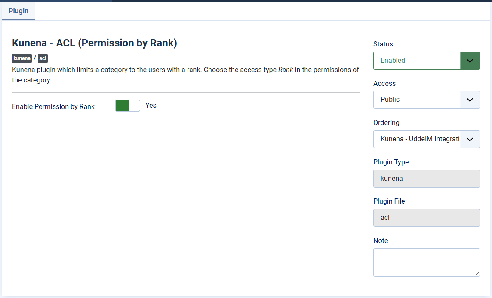

# Access by rank: the plugin Kunena - ACL

> **Label:** `feature` · **Since:** Kunena 7.2 · **For:** Administrators

Restrict a category to users with a minimum rank (by post count).

The new access plugin adds the access type **Rank** to the category form. A category can require a minimum rank (by post count),
optionally let special ranks through, and set separate minimum ranks for creating topics and for replying.

Enable the plugin *Kunena - ACL* in the plugin manager, then choose the access type *Rank* in the form of a category.

---

[← All the new features of Kunena 7.2](../README.md)
