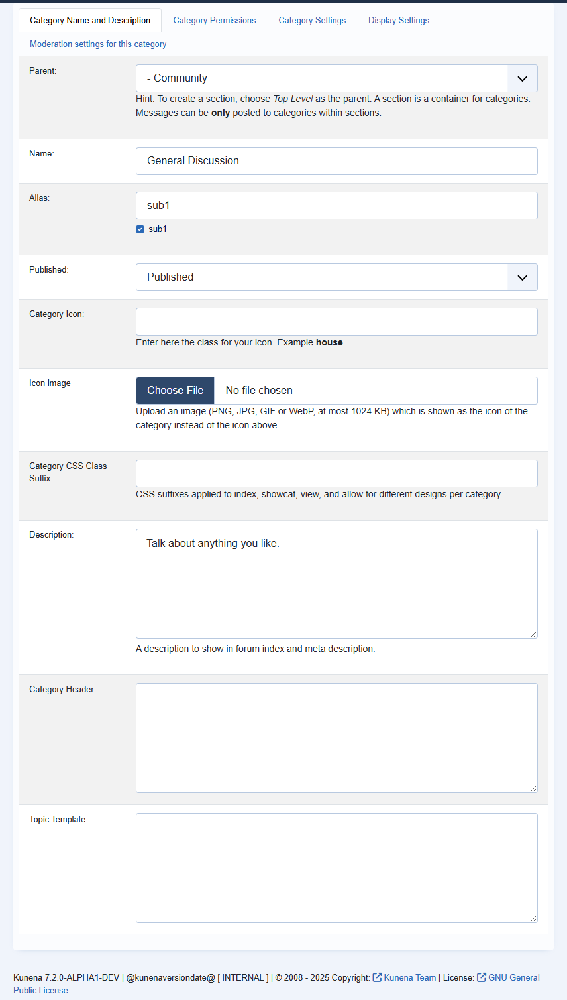

# Upload an icon image for a category

> **Label:** `feature` · **Since:** Kunena 7.2 · **For:** Administrators

A category can have its own icon image instead of an icon class.

The category form has an **Icon image** upload field (PNG, JPG, GIF or WebP, at most 1 MB) and a checkbox to remove it.

- The type is checked on the content of the file, not on its name.
- The image is saved as `media/kunena/category_images/icon_<category id>.<extension>` and replaces the icon class on the forum index (for
  the category and its subcategories). Categories without an image keep the icon class or the default icon.

---

[← All the new features of Kunena 7.2](../README.md)
