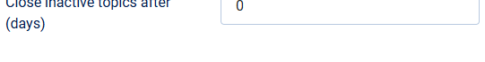
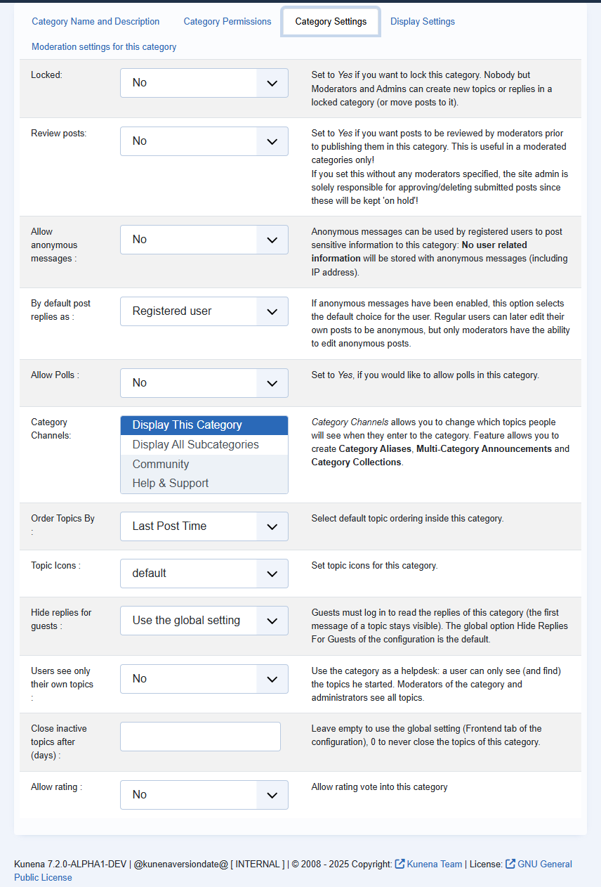

# Close inactive topics for replies

> **Label:** `feature` · **Since:** Kunena 7.2 · **For:** Administrators

After a number of days without a message, a topic can not get a reply any more.

A topic without a new message for the set number of days can not get a reply any more, so old topics are not raised. The reply buttons are
hidden and a direct reply link gives a clear message. Moderators can still reply. Reading and editing do not change.

## Options

| Option | Where | Default |
| --- | --- | --- |
| Close inactive topics after (days) | Kunena configuration, tab *Look and Feel* | 0 (never) |
| Close inactive topics after (days) | the form of a category, tab *Category Settings*: empty uses the global value, 0 never closes the topics of the category | empty |

---

[← All the new features of Kunena 7.2](../README.md)
