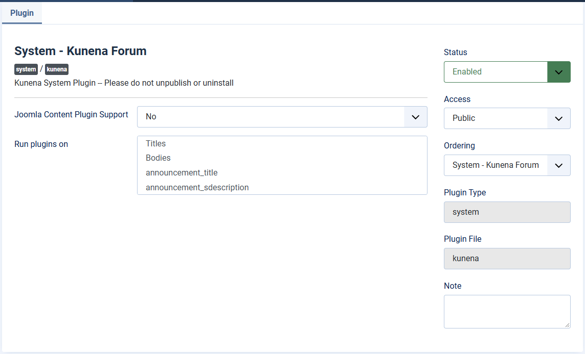

# Choose the Joomla content plugins for the forum

> **Label:** `feature` · **Since:** Kunena 7.2 · **For:** Administrators

Run only the content plugins you choose on the text of the forum.

The plugin *System - Kunena Forum* has a new option **Choose the Joomla content plugins you want to load**, shown when *Joomla Content
Plugin Support* is on. It is a multi-select of the installed content plugins. When plugins are chosen, only these run on the text of the
forum, in a dispatcher of their own which is built once for each request. An empty selection keeps running all the enabled content
plugins.

---

[← All the new features of Kunena 7.2](../README.md)
