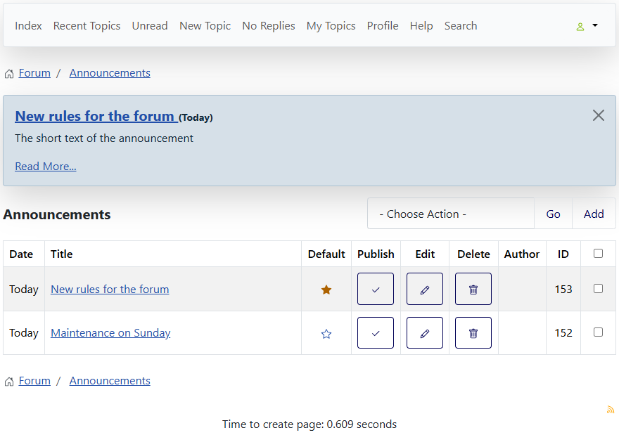

# Choose the default announcement

> **Label:** `feature` · **Since:** Kunena 7.2 · **For:** Administrators · **Issue:** [#1612](https://github.com/Kunena/Kunena-Forum/issues/1612)

The administrator chooses which announcement is the banner, with a star on the list of announcements.

The announcement which is shown in the banner at the top of the forum pages used to be the newest published one. On the list of
announcements an administrator now chooses it with the **star** in the column *Default*.

## How it looks

*The filled star marks the default announcement; a click on the open star of another row chooses that one.*

## How it works

- As long as no announcement is chosen, the newest published announcement is the default and has the filled star.
- Only an announcement which is published, and inside its dates, can be chosen. Otherwise the administrator gets the message that it can
  not be the default: publish it first (and check its dates).
- Other users only see the filled star. The choice is kept in the parameters of the component.

---

[← All the new features of Kunena 7.2](../README.md)
