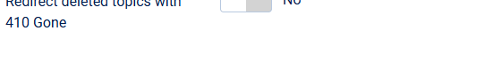

# Deleted topics answer with 410 Gone

> **Label:** `feature` · **Since:** Kunena 7.2 · **For:** Administrators

A deleted topic tells the search engines it is gone (410), instead of a 404 error.

When a topic is deleted (also when it is moved to the trash), Kunena makes an entry with the status **410 Gone** and the address of the
topic in the Joomla redirects (Components, Redirects). A restored topic loses its entry again, and only the entries Kunena made are
removed.

The forum pages answer with 410 by themselves when their address has such an entry: Kunena shows its own error pages, so the redirect
plugin of Joomla never gets the error, and the plugin is not needed.

## Options

| Option | Where | Default |
| --- | --- | --- |
| Redirect deleted topics with 410 Gone | Kunena configuration, tab *Look and Feel* | No |

---

[← All the new features of Kunena 7.2](../README.md)
