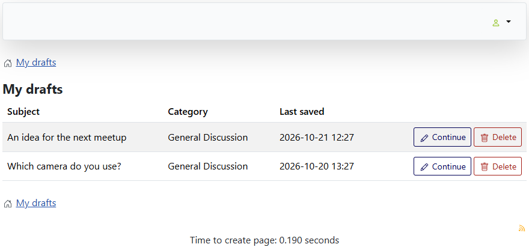

# Drafts

> **Label:** `feature` · **Since:** Kunena 7.2 · **For:** Users

Save a topic, a reply or an edit as a draft and finish it later.

A registered user can keep a message unfinished. The editor, the quick reply and the edit form get a **Save draft** button next to
Submit. The drafts are listed on a **My Drafts** page, with a button to continue and one to delete each draft.

## How it looks

*The editor of a new topic: Submit, Save draft and Cancel.*

*My Drafts: the title of a draft links to the topic it belongs to; Continue puts the text back in the editor.*

## How it works

- Drafts are stored for the user (at most 50 for each user). Posting the message, or saving the edit, removes its draft.
- **Continue** opens the editor with the saved subject, text and fields.
- The page is reached from the link in the profile box, or from a menu item of the type **My Drafts**.
- A guest is sent to the login. When the feature is off the page answers with a 404.

## Options

| Option | Where | Default |
| --- | --- | --- |
| Enable Drafts | Kunena configuration, tab *Look and Feel* | No |

---

[← All the new features of Kunena 7.2](../README.md)
