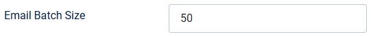

# Forum headers and threading headers in e-mails

> **Label:** `feature` · **Since:** Kunena 7.2 · **For:** Administrators

Mail programs can filter on the forum, and show the e-mails of a topic as one thread.

The e-mails of Kunena get the headers `X-Forum`, `X-Forum-URL`, `X-Forum-Name`, `X-Forum-Category`, `X-Forum-Category-Id`, `X-Forum-Topic`,
`X-Forum-Topic-Id`, `X-Forum-Post-Id`, `X-Forum-Type` (*new-topic* or *reply*) and `X-Forum-Who`, so mail programs can filter on them.

The `Message-ID` is made from the topic (the first message) or the message, and a reply gets `In-Reply-To` and `References` headers, so the
mail programs show the e-mails of a topic as one thread.

| Option | Where | Default |
| --- | --- | --- |
| Extra e-mail headers | Kunena configuration, tab *Mail* | Yes |
| Email Batch Size (e-mails for each run of the scheduled task) | tab *Subscriptions* | 50 |

---

[← All the new features of Kunena 7.2](../README.md)
