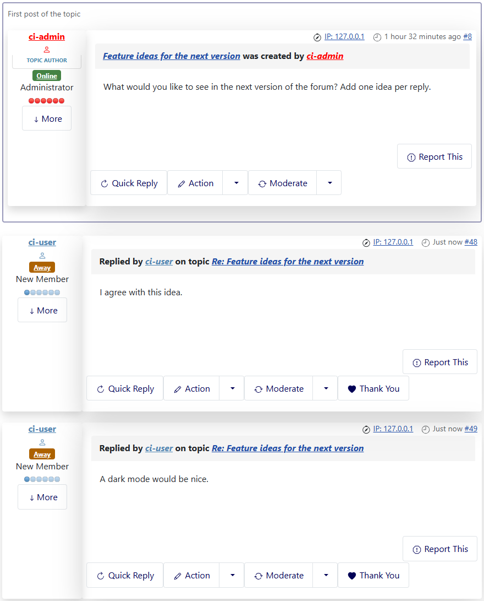

# The first post of a topic on every page

> **Label:** `feature` · **Since:** Kunena 7.2 · **For:** Users

The first message of a topic is shown on top of every page of a long topic.

In a topic with many pages the question is on page 1 only. With this option the first message is shown in a framed box above the messages
of every page which does not have it itself, so the start of the topic stays in sight.

## How it looks

*Page 2 of a topic with two messages on a page: the first post is in the box on top.*

## Options (Aurelia template)

| Option | Where | Default |
| --- | --- | --- |
| Show the first post on every page | Kunena, Templates, Aurelia, tab *Features* | No |

---

[← All the new features of Kunena 7.2](../README.md)
