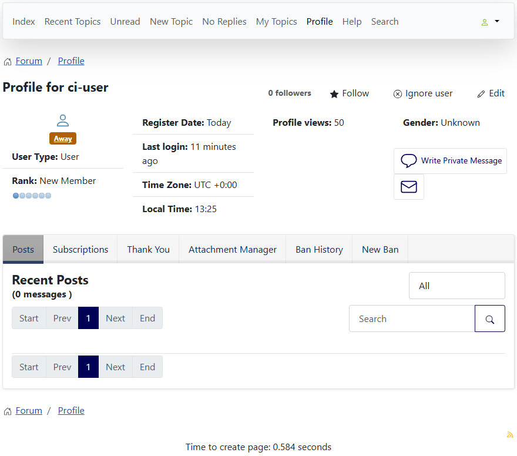
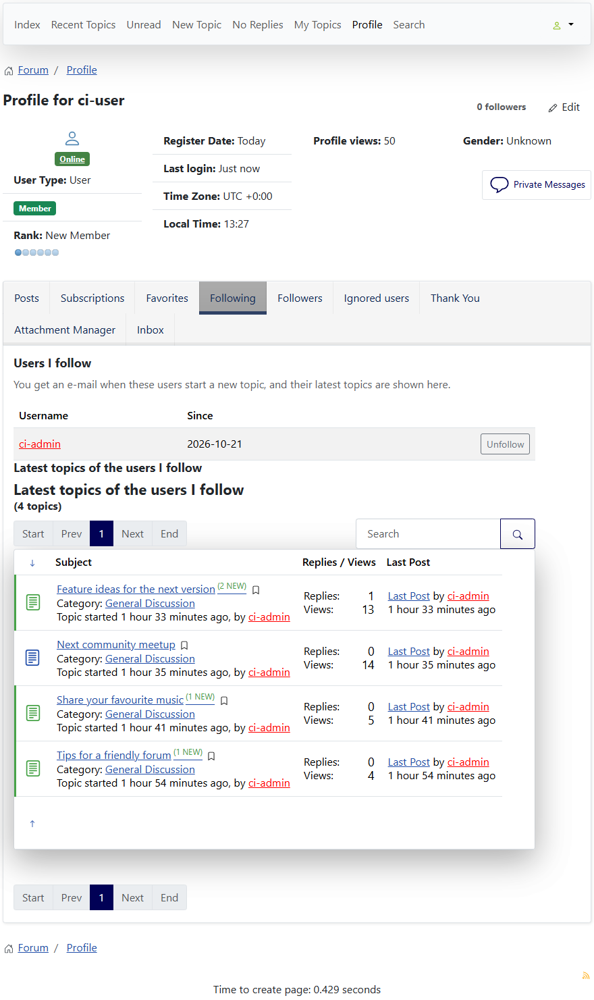
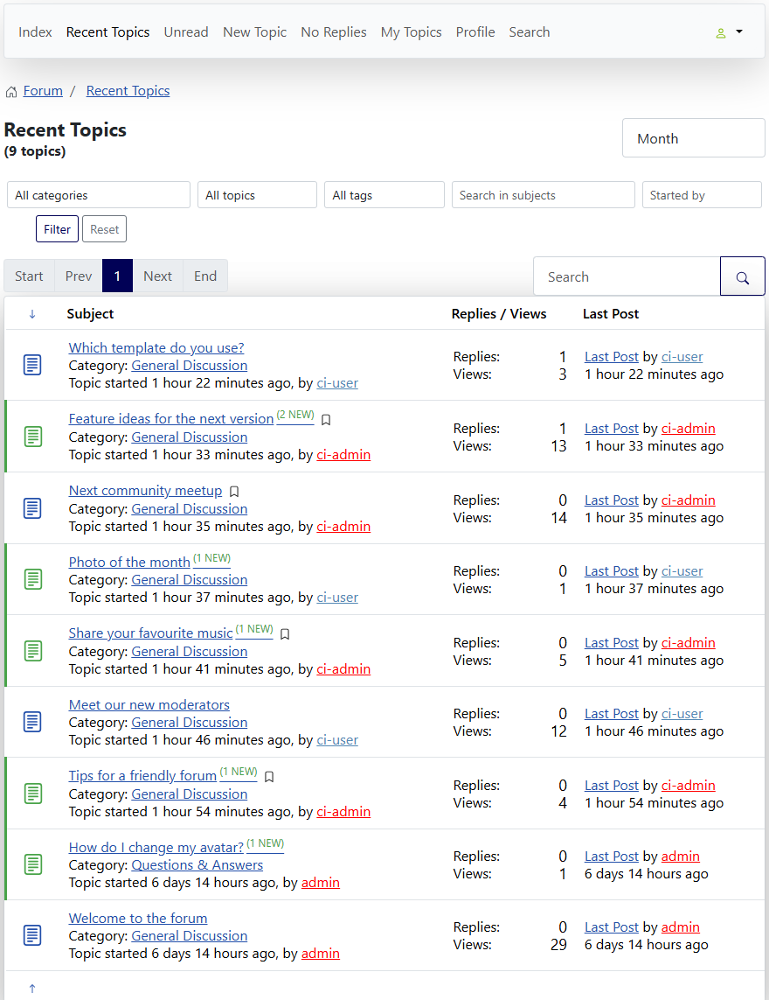
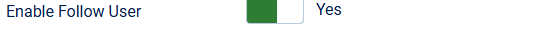

# Follow User

> **Label:** `feature` · **Since:** Kunena 7.2 · **For:** Users

Follow another user: e-mail on new topics, a list of the latest topics and a marker in the lists.

A logged-in user can follow another user with the **Follow** / **Unfollow** button on the profile of that user, which also shows the
number of followers.

## How it looks

*Topics started by a followed user have a marker (the bookmark after the title).*

## How it works

- A follower gets an **e-mail** when the followed user starts a new topic (if he may read the category and is not a subscriber of the
  category already), with a signed link to stop following.
- The own profile gets a **Following** tab (the followed users and the latest topics they started, a new `following` mode of the user topic
  list) and a **Followers** tab.
- A user on the ignore list can not be followed, and ignoring a user stops following.

## Options

| Option | Where | Default |
| --- | --- | --- |
| Enable Follow User | Kunena configuration, tab *Look and Feel* | Yes |

---

[← All the new features of Kunena 7.2](../README.md)
