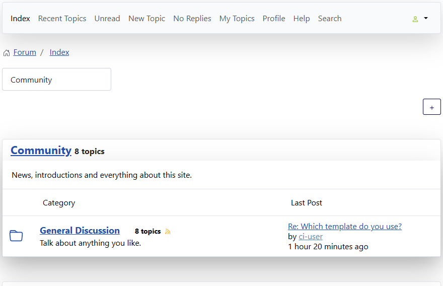
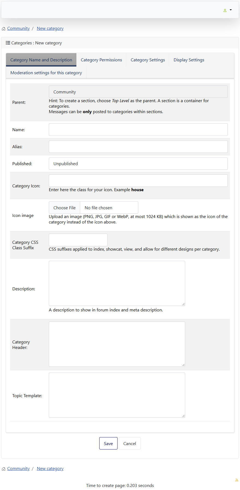

# Create, edit and delete categories in the forum

> **Label:** `feature` · **Since:** Kunena 7.2 · **For:** Administrators · **Issue:** [#3878](https://github.com/Kunena/Kunena-Forum/issues/3878)

Administrators manage sections and categories from the forum pages, without the backend.

## How it looks

*The plus buttons make a section (the one at the top, which shows when the mouse is over the row) or a category in a section.*

## How it works

- **New category / new section:** a page with the form of the category. The new category is not published and public, like in the
  backend.
- A **pencil** at the categories and the subcategories of the index, not only at the sections, opens the form to manage a category.
- **Delete** a category with a confirmation (with the number of topics and posts). A category with subcategories is kept.
- The form has the fields of the backend: language, icon image, own topics only, close inactive topics and the translations.
- Only administrators of the category can do it (checked on the pages and on the tasks).

---

[← All the new features of Kunena 7.2](../README.md)
