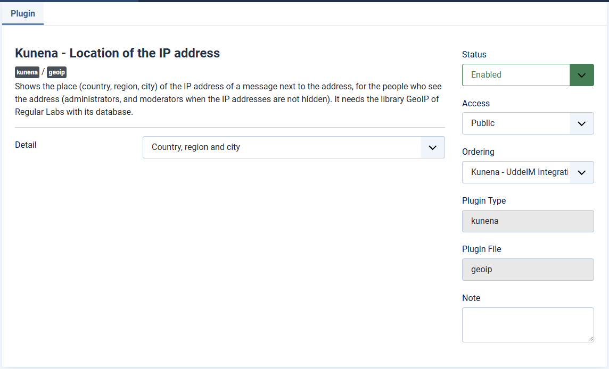

# GeoIP plugin: the place next to the IP address

> **Label:** `feature` · **Since:** Kunena 7.2 · **For:** Moderators, administrators · **Issue:** [#6771](https://github.com/Kunena/Kunena-Forum/issues/6771)

The IP address of a message gets its place (city, region and country) for the people who see the IP address.

The IP address of a message, which moderators and administrators see, gets its **place** next to it, when the plugin *Kunena - GeoIP* is
enabled. The place comes from a plugin through the event `onKunenaGetIpLocation`, so another plugin can give it too.

- **Detail:** *country*, *region* or *city*.
- The plugin uses the GeoIP database of the Regular Labs Library. Without that library and its database the plugin does nothing and the
  IP address is shown as before.

---

[← All the new features of Kunena 7.2](../README.md)
