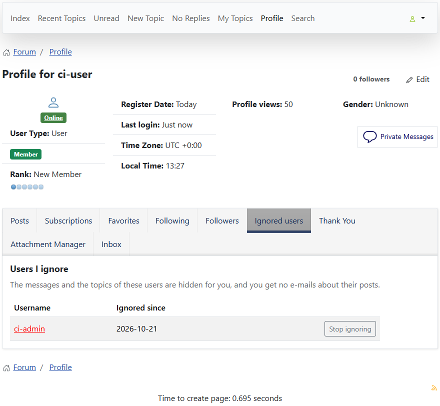
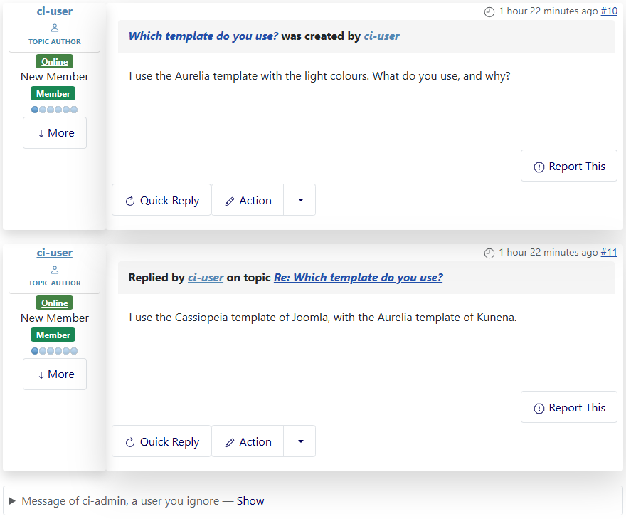
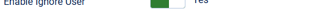

# Ignore User

> **Label:** `feature` · **Since:** Kunena 7.2 · **For:** Users

Hide the messages, topics and e-mails of a user you do not want to read.

A logged-in user can put another user on his **ignore list** from the profile of that user (**Ignore user** / **Stop ignoring**).
Moderators and administrators can not be ignored.

## How it looks

*The message of the user is collapsed, with a link to show it.*

## What changes

- The messages of an ignored user are **collapsed** in topics, with a click to show them.
- Topics started by an ignored user are left out of the lists of topics.
- Subscription e-mails about his posts are not sent.
- Users who ignore somebody do not show up in his @mention suggestions.
- The list is on the tab **Ignored users** of the own profile and on the forum settings tab, each entry with a button to stop ignoring.

## Options

| Option | Where | Default |
| --- | --- | --- |
| Enable Ignore User | Kunena configuration, tab *Look and Feel* | Yes |

---

[← All the new features of Kunena 7.2](../README.md)
