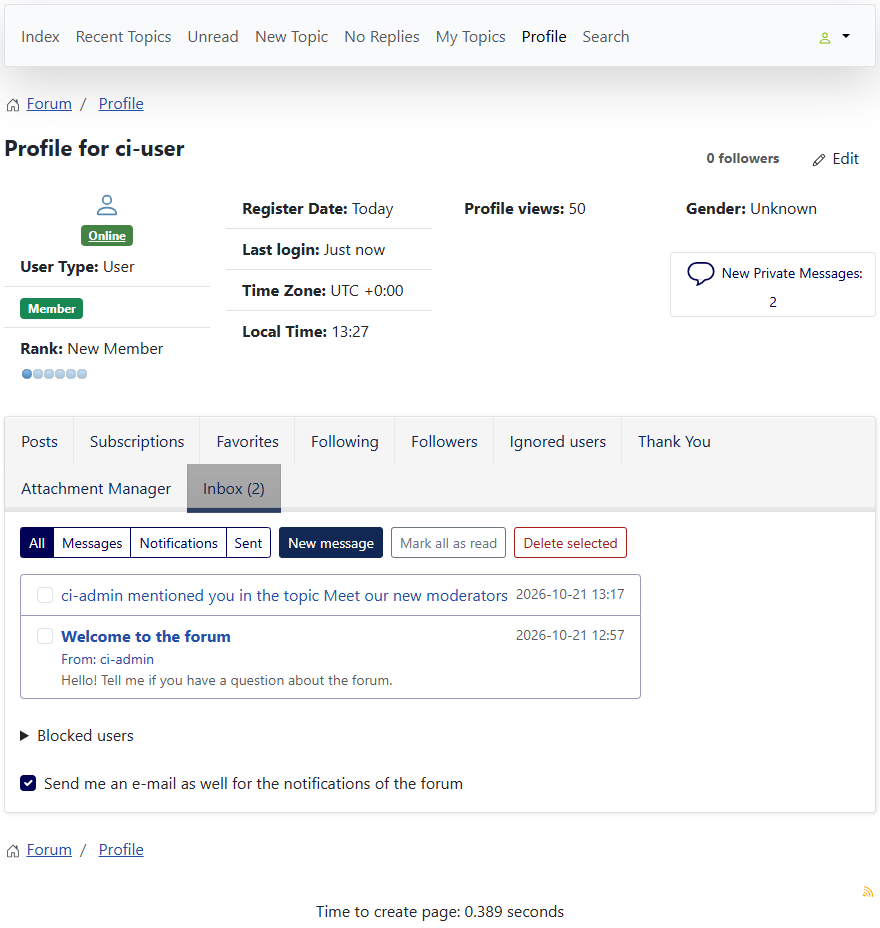
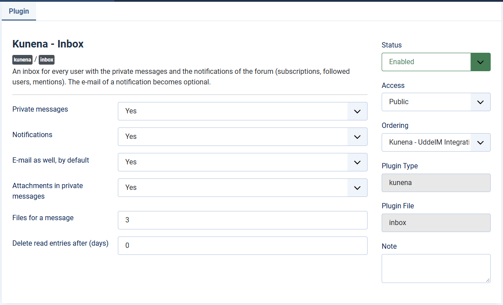

# Inbox: private messages and notifications in one place

> **Label:** `feature` · **Since:** Kunena 7.2 · **For:** Users, administrators · **Issue:** [#36](https://github.com/Kunena/Kunena-Forum/issues/36)

The plugin Kunena - Inbox gives every user private messages and a list of notifications.

The plugin **Kunena - Inbox** (with the hooks and the *Inbox* view in the core) puts the private messages and the notifications of the
forum in one inbox.

## How it looks

*The inbox lists a private message and a notification about a mention. The tab shows the number of unread items.*

## What it does

- **Private messages** with replies, attachments (the types and sizes of the forum, stored with a random name and only given to the sender
  and the recipient) and blocking of users.
- **Notifications** of subscriptions, followed users, moderation, mentions and thanks. Every user chooses whether the e-mail is sent as well.
- The inbox is a **tab of the own profile** and a **page for the Inbox menu item**. The message buttons and the *Inbox (N new)* link use it.
- Optional deletion of read notifications after a number of days.
- A guest who opens the inbox is sent to the login and comes back to the inbox.

## The settings of the plugin

| Setting | Default |
| --- | --- |
| Private messages | Yes |
| Notifications | Yes |
| E-mail as well, by default | Yes |
| Attachments in private messages / Files for a message | Yes / 3 |
| Delete read entries after (days) | 0 (never) |

---

[← All the new features of Kunena 7.2](../README.md)
