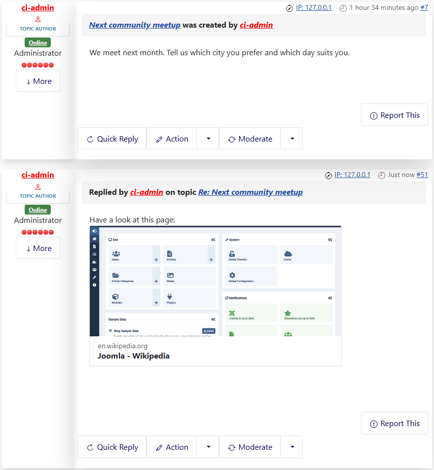
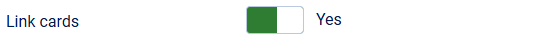
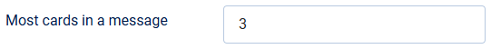
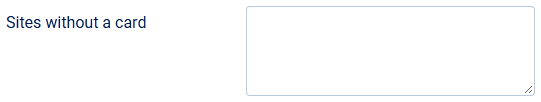

# Link cards for pasted links

> **Label:** `feature` · **Since:** Kunena 7.2 · **For:** Administrators, users · **Issue:** [#3769](https://github.com/Kunena/Kunena-Forum/issues/3769)

A link in a message becomes a card with the title, a short text and the picture of the page.

When a user pastes a link in a message, the forum shows a **card** with the title, a short description and the picture of the page, like
the previews of a chat program.

## How it looks

*The link `https://en.wikipedia.org/wiki/Joomla` as a card.*

## How it works

- The server reads the page once and keeps the card for a week. The picture is loaded by the visitor from the other site.
- A link written with the `[url]` tag stays a normal link, and so do the links after the first ones: at most the set number of cards is
  shown in a message.
- The forum itself and the sites in the list *Sites without a card* never get a card. The server only reads web pages and never
  addresses of its own network, and it does not follow redirects.

## Options

| Option | Where | Default |
| --- | --- | --- |
| Link cards | Kunena configuration, tab *BBCode Settings* | Yes |
| Most cards in a message | same tab | 3 |
| Sites without a card | same tab (one domain on each line, subdomains included) | empty |

---

[← All the new features of Kunena 7.2](../README.md)
