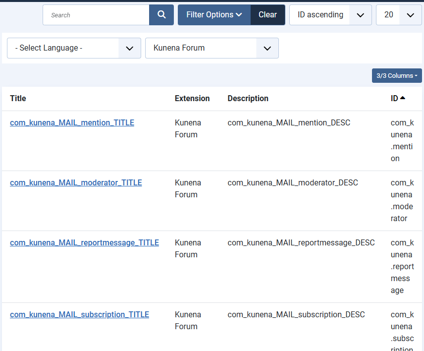
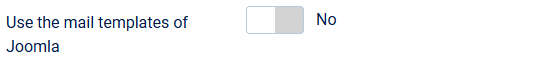

# Mail templates of Joomla for the e-mails of the forum

> **Label:** `feature` · **Since:** Kunena 7.2 · **For:** Administrators · **Issue:** [#6639](https://github.com/Kunena/Kunena-Forum/issues/6639)

The e-mails of the forum can be edited as mail templates in Joomla, in HTML or plain text.

The e-mails of the forum can be made from the **mail templates of Joomla** (Users, Mail Templates). The subject and the text are edited
there, with tags like `{TOPIC}` and `{URL}`, in HTML and plain text.

## How it looks

## Templates

| Template | For |
| --- | --- |
| `com_kunena.subscription` | a reply or a new topic for the subscribers |
| `com_kunena.moderator` | a new message for the moderators |
| `com_kunena.mention` | the e-mail to a mentioned user |
| `com_kunena.reportmessage` | a reported message |

The templates come with a modern HTML layout. With the option off, or when a template is missing, the e-mails are made as before.

## Options

| Option | Where | Default |
| --- | --- | --- |
| Use the mail templates of Joomla | Kunena configuration, tab *Mail* | No |

---

[← All the new features of Kunena 7.2](../README.md)
