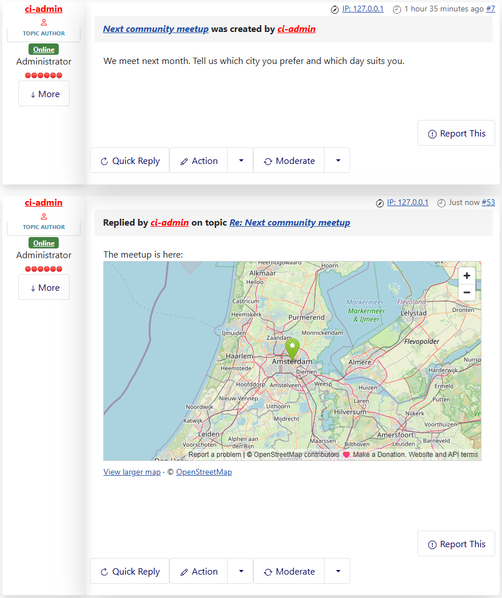
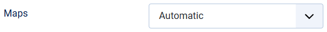
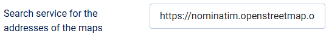

# Maps with OpenStreetMap

> **Label:** `feature` · **Since:** Kunena 7.2 · **For:** Administrators, users · **Issue:** [#6088](https://github.com/Kunena/Kunena-Forum/issues/6088)

The [map] BBCode and the location links can use OpenStreetMap, without a key.

The `[map]` BBCode and the location of a profile used Google Maps only, which needs an API key and a billing account. OpenStreetMap is now
a provider too.

## How it looks

*The message `[map]Amsterdam, Netherlands[/map]`.*

## How it works

- With **Automatic** the forum uses Google Maps when a Google Maps API key is filled in, and OpenStreetMap when it is not.
- The OpenStreetMap map is the embed of openstreetmap.org with a marker and the zoom of the BBCode. There is no key and no script of a
  third party.
- OpenStreetMap needs the coordinates of an address. They come from a Nominatim search service, once for every address; the answer is kept
  in the cache of Joomla (at most 3 lookups for a page). The public service of OpenStreetMap is the default; for a busy forum use your own.
- The fallback link of the BBCode, and the location of a profile, follow the provider.

## Options

| Option | Where | Default |
| --- | --- | --- |
| Maps | Kunena configuration, tab *BBCode Settings*: Automatic, Google Maps or OpenStreetMap | Automatic |
| Search service for the addresses of the maps | same tab | `https://nominatim.openstreetmap.org/search` |

---

[← All the new features of Kunena 7.2](../README.md)
