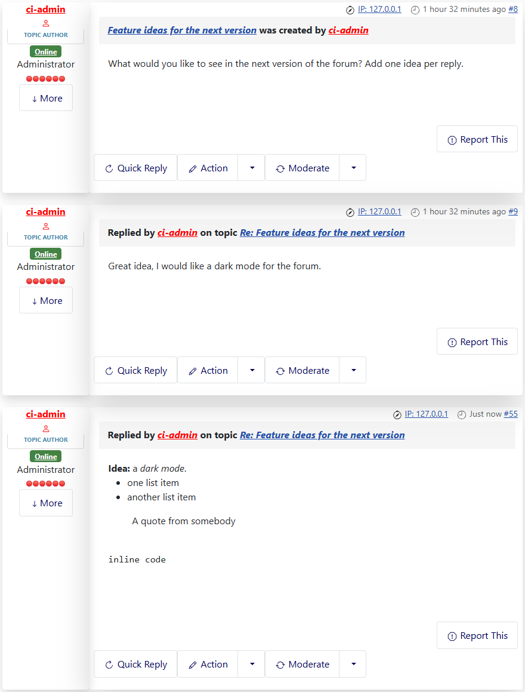
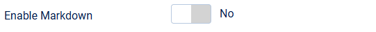
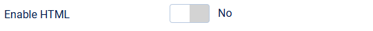

# Markdown and safe HTML in messages

> **Label:** `feature` · **Since:** Kunena 7.2 · **For:** Administrators, users

Messages can use Markdown, and a safe set of HTML tags, next to BBCode.

Two new options let users write in Markdown or in a small set of HTML tags. Kunena converts the message to BBCode first, so the BBCode
renderer stays the only code which makes the HTML of a message; unknown tags and all attributes stay plain text.

## How it looks

*The message was written as `**Idea:** a *dark mode*.`, a list, a quote and `inline code`.*

## What is allowed

- **Markdown:** `**bold**`, `*italic*`, `~~strikethrough~~`, headings, lists, quotes, `code`, code blocks, links, images and tables.
- **HTML:** `b`, `strong`, `i`, `em`, `u`, `s`, `sup`, `sub`, `a` (href), `img` (src), headings, lists, tables, `blockquote`, `pre` and `code`.
- Links and images only accept web, mail and site addresses. Existing BBCode, code blocks and links are not touched.

Existing messages with characters like `*` or `_` can look different when Markdown is switched on.

## Options

| Option | Where | Default |
| --- | --- | --- |
| Enable Markdown | Kunena configuration, tab *BBCode Settings* | No |
| Enable HTML | Kunena configuration, tab *BBCode Settings* | No |

---

[← All the new features of Kunena 7.2](../README.md)
