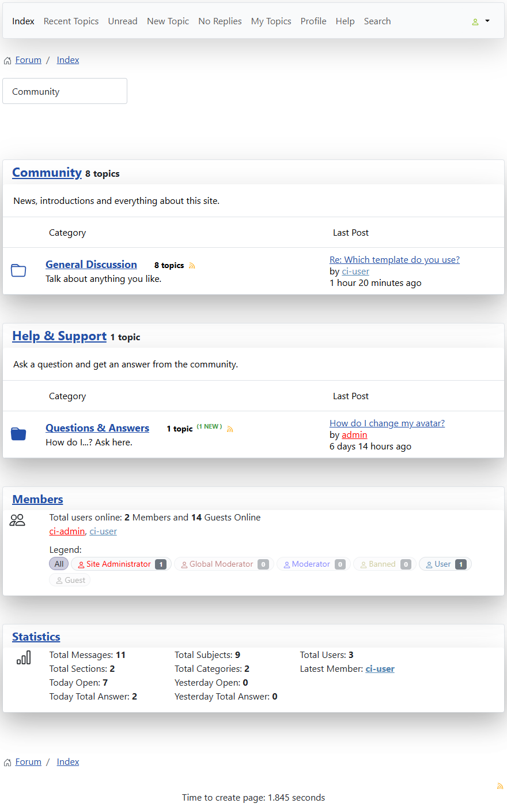

# Members box: filter the online users by role

> **Label:** `feature` · **Since:** Kunena 7.2 · **For:** Users

Click a chip of the legend to show only the online users with that role.

The **Members** box of the forum index shows who is online. The chips of the legend (*Site Administrator*, *Global Moderator*, *Moderator*,
*Banned*, *User*, *Guest*) now **filter** the list: a click on a chip shows only the online users with that role (more chips can be chosen together); *All* shows
everybody.

---

[← All the new features of Kunena 7.2](../README.md)
