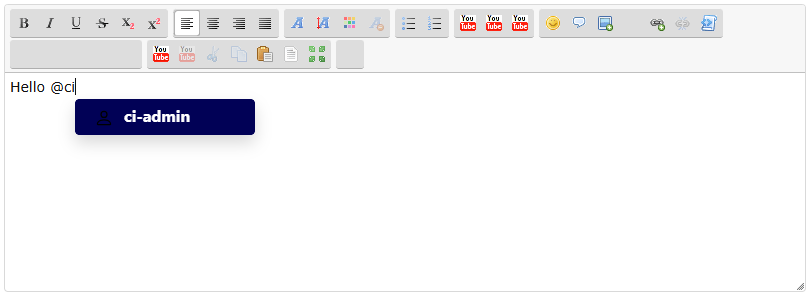
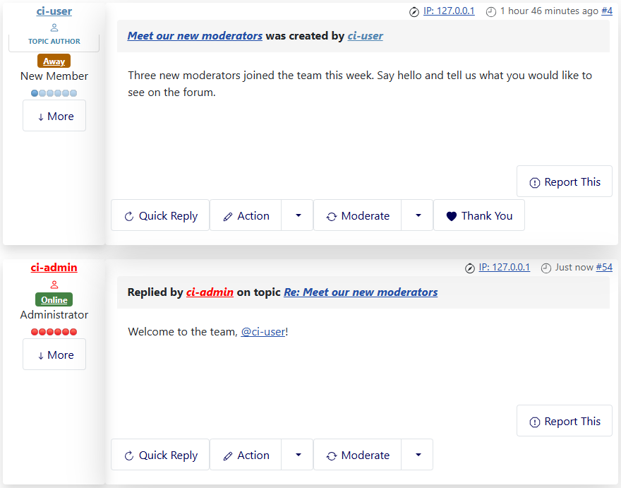
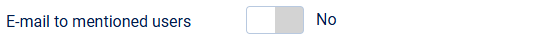

# Mentions: search while typing, e-mail and SCEditor

> **Label:** `feature` · **Since:** Kunena 7.2 · **For:** Users

Typing @ and some letters finds the users, also on a new topic and in the SCEditor, and a mentioned user can get an e-mail.

Mentioning a user (`[mention userid=..]name[/mention]`) is improved in three ways.

## Search while you type

A new topic has no users yet, so the list of users to mention was empty there. Typing `@` and some letters now searches the users (by
username, real name or nickname) who may read the category. It works in the CKEditor and in the SCEditor. Users who are blocked, who
ignore the author, or who may not read the category are left out.

## A mention in a message

## E-mail to the mentioned user

A user who is mentioned in a new post gets an e-mail with a link to the post. An edit only mails the users who were not mentioned before.
There is no e-mail for the author, for users who ignore the author, who are blocked or may not read the post, and for users who already
get the notification e-mail of the post. A user can switch it off with **E-mail me when I am mentioned** in the forum settings of the
profile (on by default).

## The SCEditor

Typing `@` in the SCEditor shows the users of the topic and inserts `[mention userid=..]name[/mention]`. The poll button is in the
toolbar when polls are possible, and images pasted into the editor are removed with a warning, like in the CKEditor.

## Options

| Option | Where | Default |
| --- | --- | --- |
| E-mail to mentioned users | Kunena configuration, tab *Mail* | No |

---

[← All the new features of Kunena 7.2](../README.md)
