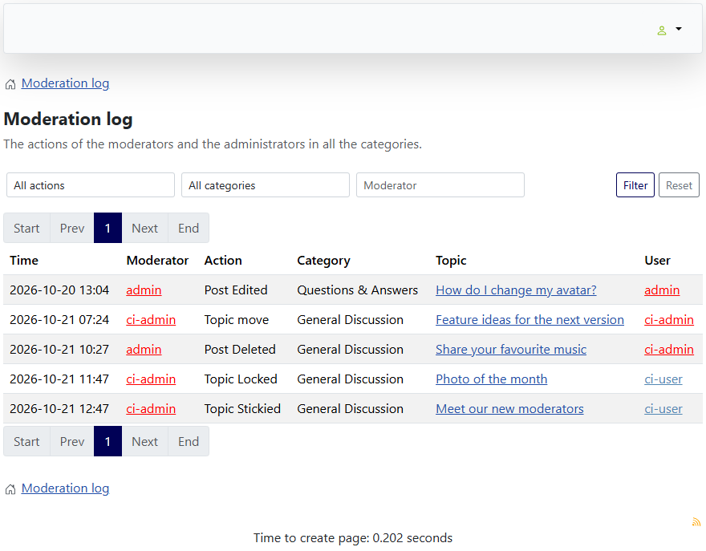

# Frontend moderation log

> **Label:** `feature` · **Since:** Kunena 7.2 · **For:** Moderators, administrators

A page with the actions of the moderators, in the forum itself.

The new page **Moderation log** (`view=topic&layout=modlog`) lists the moderation actions of the forum log.

## How it looks

## How it works

- Columns: time, moderator, action, category, topic and the user the action was about; 25 on a page. Operations without a translation get a
  readable text.
- Administrators see everything. A moderator only sees the actions in the categories which he moderates. Other users get a 403.
- The list can be filtered on the action, the category and the moderator; the list reloads in the background with the filters in the
  address, and the form also works without JavaScript.
- It is reached from a link in the profile box (moderators and administrators only).
- The log is only filled when the option *Define if you want to log action or moderation* of the configuration is on. An
  administrator sees a warning on the page when it is off.

---

[← All the new features of Kunena 7.2](../README.md)
