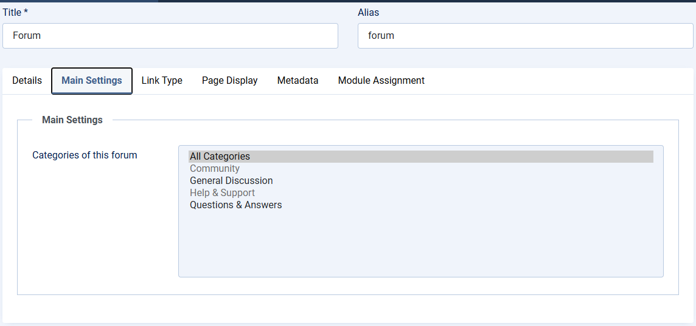

# Multiple forums on one site

> **Label:** `feature` · **Since:** Kunena 7.2 · **For:** Administrators · **Issue:** [#780](https://github.com/Kunena/Kunena-Forum/issues/780)

A Forum Home menu item can show only its own categories.

A site can have more than one forum. The menu item of the type *Forum Home* has a new option **Categories of this forum**: the pages
below that item (the index, the lists of topics, the search, a new topic, the category and topic pages) only show those categories and their
subcategories.

## How it looks

## How it works

- A category or topic of another forum goes (with a 301) to the Forum Home item which has it.
- Users, ranks, configuration and statistics are shared by all the forums.

---

[← All the new features of Kunena 7.2](../README.md)
