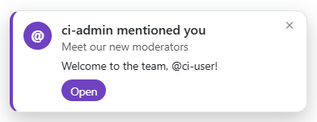
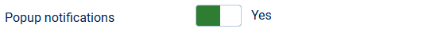
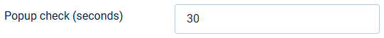

# Popup notifications

> **Label:** `feature` · **Since:** Kunena 7.2 · **For:** Users, administrators

A modern popup with a link when you are mentioned, get a reply, or a topic starts in a category you follow.

While a forum page is open, a small popup appears with a link to the message when:

- the user is **mentioned**;
- somebody **replies in his topic**, or in a topic he follows;
- somebody **starts a topic** in a category he follows.

## How it looks

## How it works

- The browser asks the server for new items every few seconds, while the page is visible. The first time it only takes the position, so
  nobody gets popups for what happened before.
- One popup for a message, with the strongest reason: a mention, then a reply in an own topic, then a topic the user follows, then a new topic
  in a followed category. At most 3 popups are shown at once, with a note for the rest.
- Only messages of the last 24 hours are shown. The user can switch the popups off with **Show popups for mentions and replies** in his own
  forum settings.

## Options

| Option | Where | Default |
| --- | --- | --- |
| Popup notifications | Kunena configuration, tab *Mail* | Yes |
| Popup check (seconds) | same tab (minimum 10) | 30 |

---

[← All the new features of Kunena 7.2](../README.md)
