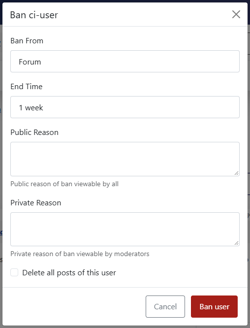
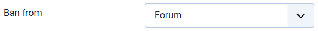
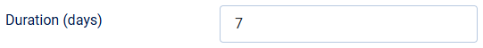

# Ban button on messages

> **Label:** `feature` · **Since:** Kunena 7.2 · **For:** Moderators, administrators · **Issue:** [#4158](https://github.com/Kunena/Kunena-Forum/issues/4158)

Ban a user from the Moderate menu of a message, with the duration and the reason in one box.

The **Moderate** menu of a message has a new entry **Ban user**. It is not shown for administrators, moderators, yourself and users who
are banned already.

## How it looks

## How it works

- The box asks for the duration, the public and the private reason, and has **Delete all posts of this user**.
- It uses the existing ban task: the ban is logged, the e-mail is sent and the user is reported to StopForumSpam as before. The page comes
  back to the message.
- Moderators ban from the forum. Only administrators can block the user from the whole site (**Ban from**: *Site*).

## Options

| Option | Where | Default |
| --- | --- | --- |
| Ban button on messages | Kunena configuration, tab *User Related* | Yes |
| Ban from | same tab, start value of the box: Forum or Site | Forum |
| Duration (days) | same tab, 0 is permanent | 7 |
| Delete the posts too | same tab, start value of the checkbox | No |

---

[← All the new features of Kunena 7.2](../README.md)
