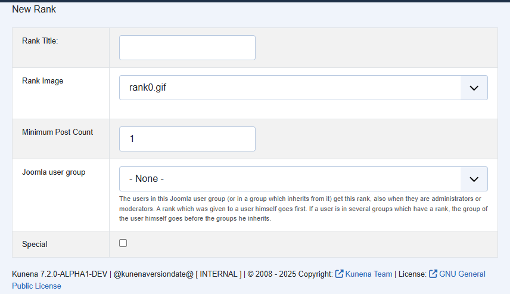

# Ranks linked to a Joomla user group

> **Label:** `feature` · **Since:** Kunena 7.2 · **For:** Administrators · **Issue:** [#8339](https://github.com/Kunena/Kunena-Forum/issues/8339)

A rank can be given to every member of a Joomla user group.

The form of a rank has a new field **Joomla user group**, and the list of ranks shows the group.

## How it looks

## How it works

- A user who is in the group (or in a group which inherits from it) gets the rank.
- The rank goes before the ranks of the administrators and moderators, but after a rank which was given to the user himself. A group of
  the user itself goes before the groups he inherits.
- The links are kept in the parameters of the component and survive a save of the configuration. Deleting a rank removes its link.

---

[← All the new features of Kunena 7.2](../README.md)
