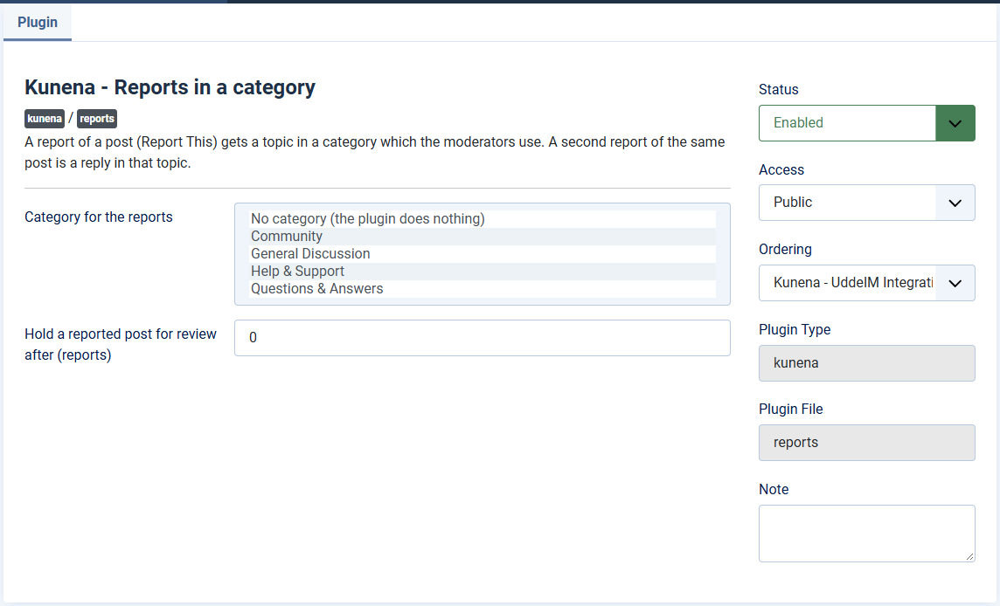

# Reports: handled by plugins, and the plugin Reports in a category

> **Label:** `feature` · **Since:** Kunena 7.2 · **For:** Moderators, administrators · **Issue:** [#1077](https://github.com/Kunena/Kunena-Forum/issues/1077)

A report of a post can become a topic for the moderators, and the e-mail to the moderators is an option.

## Plugins can handle a report

A plugin can handle a report of a message through the event `onKunenaReportMessage`. The e-mail to the moderators is now an option; a report
is only refused for the mail settings when no plugin handles it. The moderators get the report in their inbox as well (type *report*).

| Option | Where | Default |
| --- | --- | --- |
| E-mail to moderators for reports | Kunena configuration, tab *Mail* | No |

## The plugin Kunena - Reports in a category

A report of a post (*Report This*) becomes a **topic in a chosen category** for the moderators: the reporter, the reason, the text and the
quoted post. A second report of the same post is a reply in that topic.

- **Category for the reports:** the category which the moderators use. *No category* makes the plugin do nothing.
- **Hold a reported post for review after (reports):** a post which that number of different users have reported is held (unapproved)
  until a moderator approves it. Posts of moderators and first posts are never held. 0 never holds.

---

[← All the new features of Kunena 7.2](../README.md)
