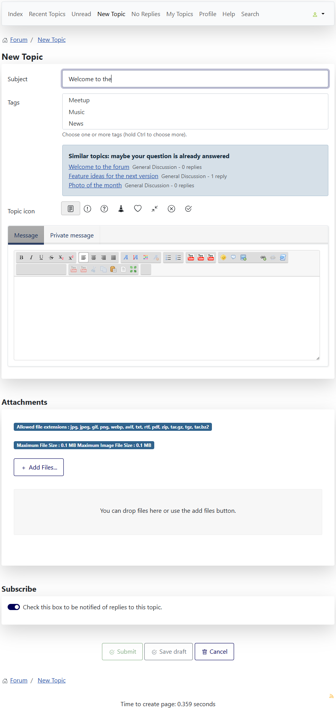

# Suggest similar topics

> **Label:** `feature` · **Since:** Kunena 7.2 · **For:** Users

While the subject of a new topic is typed, topics with a similar subject are shown.

Before somebody starts a topic, the forum shows the topics with a similar subject, so a question which is answered already is found at
once.

## How it looks

*The subject `Welcome to the` shows three topics, the best match first.*

## How it works

- Only topics the user may read are suggested (and, on a multilanguage site, those of the language of the page).
- The suggestions come from the task `topic.similar` (JSON).

## Options (Aurelia template)

| Option | Where | Default |
| --- | --- | --- |
| Suggest similar topics | Kunena, Templates, Aurelia, tab *Features* | No |
| Number of similar topics (1 - 10) | same tab | 5 |

---

[← All the new features of Kunena 7.2](../README.md)
