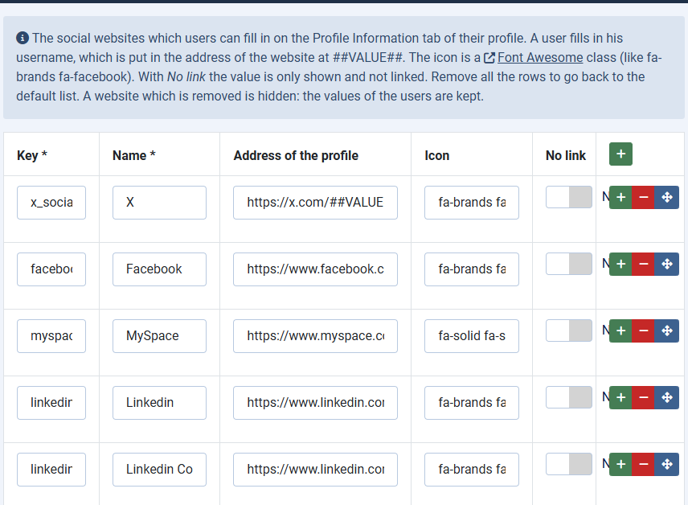

# Social websites: edit the providers, retire the dead ones

> **Label:** `feature` · **Since:** Kunena 7.2 · **For:** Administrators

A view to add and remove the social websites of the profile; Skype, Yahoo Messenger and Google+ are gone.

## The view Social websites

The new view *Components, Kunena Forum, Social websites* has a table of the providers which users can fill in on the *Profile Information*
tab of their profile: key, name, the address of the profile (`##VALUE##` is the username of the user), the icon (a Font Awesome class) and
*No link* (the value is shown without a link).

- The list is kept in the parameters of the component and survives a save of the configuration. Remove all the rows to go back to the
  default list.
- The address, the name and the icon of a provider come from the list for all the users. The values of the users are kept: a removed
  provider is only hidden.
- The address must be `http(s)` or the link of a messenger, never `javascript:`.

## Retired providers

**Skype**, **Yahoo Messenger** and **Google+** are shut down. They are not in the default list any more and are never shown, also not with
the values users have stored. The update to 7.2 removes their values from the profiles of all users (in the update file of Joomla and in
the upgrade of the installer).

---

[← All the new features of Kunena 7.2](../README.md)
