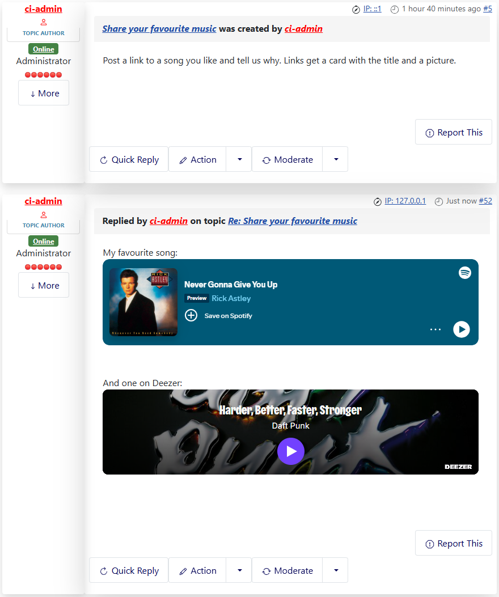

# Spotify and Deezer players

> **Label:** `feature` · **Since:** Kunena 7.2 · **For:** Administrators, users · **Issue:** [#3769](https://github.com/Kunena/Kunena-Forum/issues/3769)

A link to a Spotify or Deezer track, album, playlist, show or episode is shown as the player of that service.

A pasted link to Spotify or Deezer is shown as the player of the service, so the visitors can listen without leaving the forum.

## How it looks

## What is supported

Tracks, albums, playlists, shows and episodes of **Spotify** (`open.spotify.com`) and **Deezer** (`deezer.com`).

## Options

| Option | Where | Default |
| --- | --- | --- |
| Auto Embed Spotify items | Kunena configuration, tab *BBCode Settings* | Yes |
| Auto Embed Deezer items | same tab | Yes |

---

[← All the new features of Kunena 7.2](../README.md)
