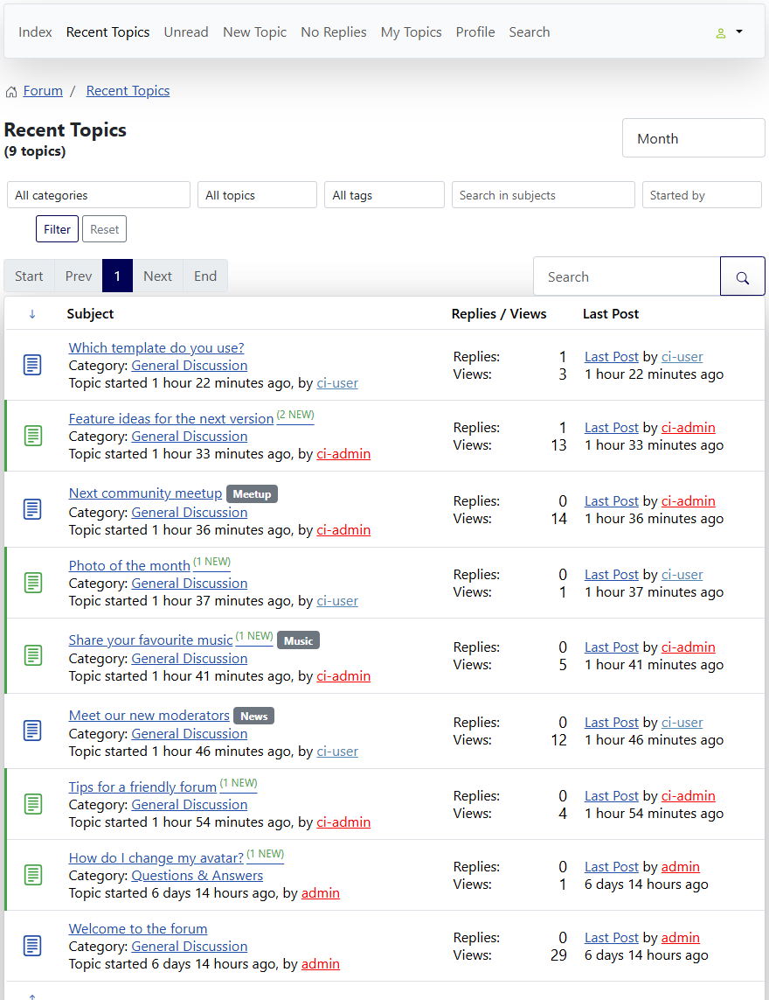
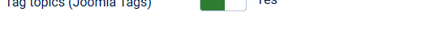

# Tag topics with Joomla Tags

> **Label:** `feature` · **Since:** Kunena 7.2 · **For:** Administrators, moderators, users

Topics get tags of the Joomla component Tags, shown as labels and usable as a filter.

Topics can be tagged with the tags of the Joomla component **Tags** (Components, Tags).

## How it looks

*The form of a new topic has a Tags field (see the first lines).*

*The tags are shown after the title of the topic.*

## How it works

- The author of the topic, and the moderators, choose tags in the editor of a new topic or of the first message of a topic. Users can
  only choose existing, published tags which they may see.
- The tags are kept in the Joomla tag map (`#__contentitem_tag_map`, type alias `com_kunena.topic`) and removed when the topic is deleted.
- The tags are shown on the topic and in the lists of topics as links; the lists have a **tag filter** (also `ftag` in the address).

## Options

| Option | Where | Default |
| --- | --- | --- |
| Tag topics (Joomla Tags) | Kunena configuration, tab *Look and Feel* | No |

---

[← All the new features of Kunena 7.2](../README.md)
