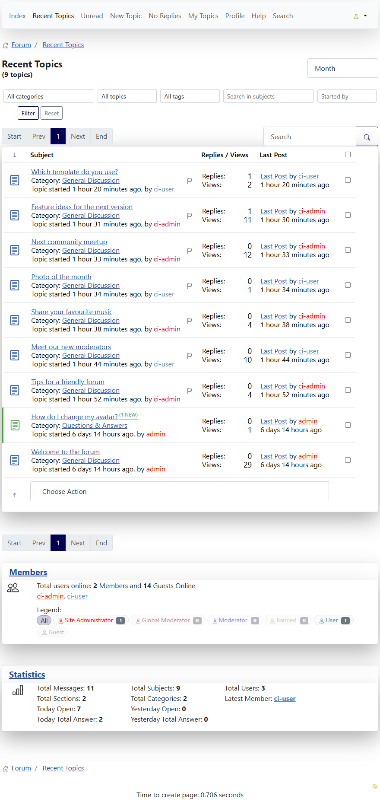

# Filter bar on the lists of topics

> **Label:** `feature` · **Since:** Kunena 7.2 · **For:** Users

Filter a list of topics on category, status, tag, words in the subject and author, without leaving the page.

The lists of topics (recent, new, no replies, sticky, locked, unread, my topics, moderator) have a **filter bar**.

## How it looks

## How it works

- Filters: **category**, **status** (no replies, with replies, sticky, locked, with a poll), **tag**, a search **in the subjects** and
  the name of the **author** (*Started by*).
- The server does the filtering, so the counts and the pages are right. The template asks for the list again with the filters in the
  address and replaces the rows, the pagination and the count without leaving the page. The filters survive a reload and the back button.
- Without JavaScript the form works as a normal form.

---

[← All the new features of Kunena 7.2](../README.md)
