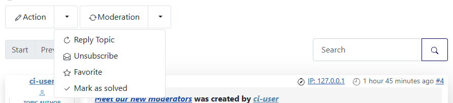
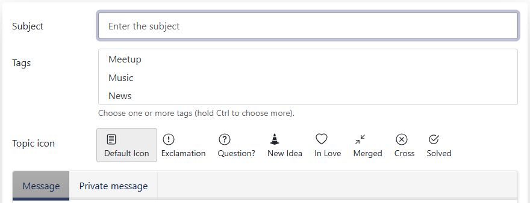

# Topic status: Mark as solved

> **Label:** `feature` · **Since:** Kunena 7.2 · **For:** Users, moderators · **Issue:** [#5146](https://github.com/Kunena/Kunena-Forum/issues/5146)

A Mark as solved button, the name under the topic icons and a batch status for moderators.

## Mark as solved

The actions of a topic have a **Mark as solved** / **Mark as not solved** button. The author of the topic (when it is not locked) and the
moderators can use it.

## Set the status of many topics

Moderators of a category get a bulk action **Set the status of the selected topics** (with the choice of the topic icon) on the category
page and in the lists of topics.

## Text under the topic icons

The name of each icon is shown under it in the form of a new topic.

## Options (Aurelia template)

| Option | Where | Default |
| --- | --- | --- |
| Text under the topic icons | Kunena, Templates, Aurelia, tab *Features* | Yes |

---

[← All the new features of Kunena 7.2](../README.md)
