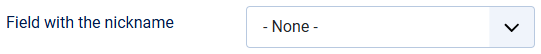

# Three names for a user: username, real name and nickname

> **Label:** `feature` · **Since:** Kunena 7.2 · **For:** Administrators, users

Show the username, the real name or a nickname, and let users choose.

The option *Name of a user* is now a choice of **Username**, **Real name** or **Nickname** (the old Yes/No values keep their meaning).

## How it works

- The nickname is a field of the Joomla users (Users, Fields). Choose that field in the configuration; a field which is unpublished or
  deleted is ignored. Make the field editable by the users in the profile.
- When the chosen name is empty the next one is shown (nickname, real name, username).
- With **Users choose their name** the users choose in their forum settings which of their names the others see.
- The names are used everywhere (also in the mention list); the user list and the user search find users by any of the three names.

## Options

| Option | Where | Default |
| --- | --- | --- |
| Field with the nickname | Kunena configuration, tab *User Related* | none |
| Users choose their name | same tab | No |

---

[← All the new features of Kunena 7.2](../README.md)
