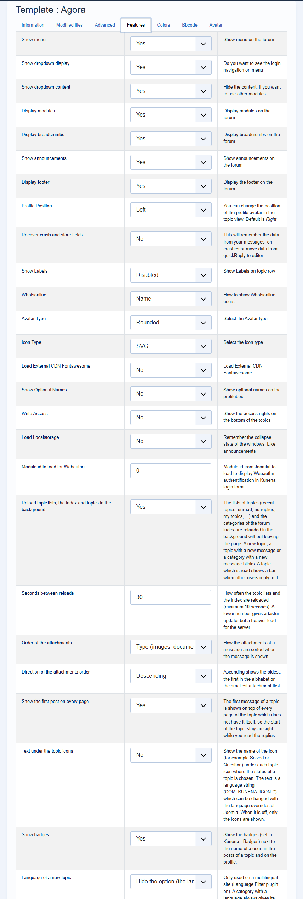

# Topic lists, index and topics reload in the background

> **Label:** `feature` · **Since:** Kunena 8.0 · **For:** Users

The lists of topics and the forum index update by themselves, and new items blink; an open topic shows its new replies.

The lists of topics (recent topics, unread, no replies, my topics, moderator) and the categories of the index are fetched again in the
background, and only the changed rows are replaced. A new topic, a topic with a new message or a category with a new message blinks; the
relative times of the other rows move on. Nothing happens while the tab is hidden or while a row is checked.

## New replies in the topic which is read

A topic which is open asks in the background whether other users replied to it since the page was opened. When they did, a bar at
the top of the topic says how many (*2 new replies in this topic.*) with a link **Show them** to the first new reply, and the title of
the tab starts with the number, as *(2) The subject*. The user's own replies are not counted, nor the replies waiting for approval.
Nothing is asked while the tab is hidden; a tab which comes back asks at once.

## Options (Aurelia template)

| Option | Where | Default |
| --- | --- | --- |
| Reload topic lists, the index and topics in the background | Kunena, Templates, Aurelia, tab *Features* | Yes |
| Seconds between reloads (minimum 10) | same tab | 30 |

---

[← All the new features of Kunena 8.0](../README.md)
