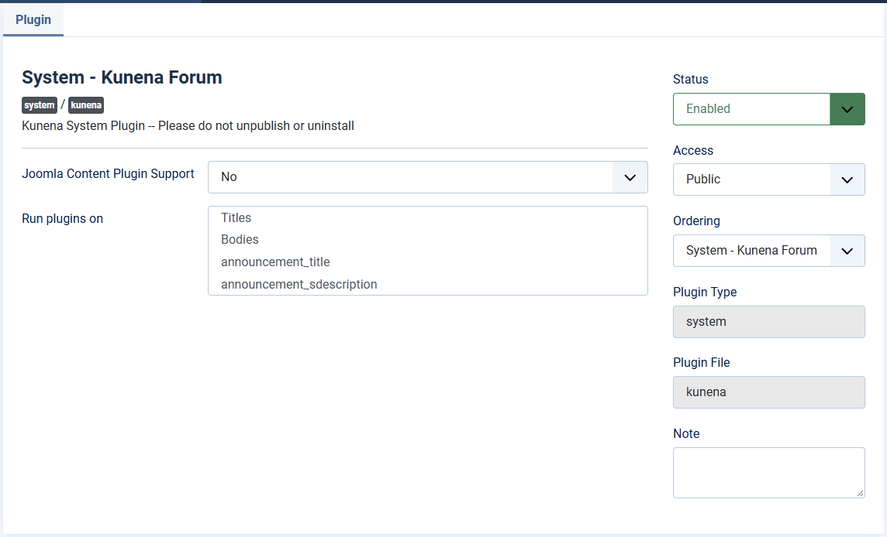

# Choose the Joomla content plugins for the forum

> **Label:** `feature` · **Since:** Kunena 8.0 · **For:** Administrators

Run only the content plugins you choose on the text of the forum.

The plugin *System - Kunena Forum* has a new option **Choose the Joomla content plugins you want to load**, shown when *Joomla Content
Plugin Support* is on. It is a multi-select of the installed content plugins. When plugins are chosen, only these run on the text of the
forum, in a dispatcher of their own which is built once for each request. An empty selection keeps running all the enabled content
plugins.

**Run plugins on** also has a target for the modules of each module position of the forum: the top and bottom of every page, the
login box, the forum index and its sections, the lists of topics and of posts, the title, poll and messages of a topic, the profile of
the author of a message and the summary of a profile. A content plugin can then change the modules there (a `{loadmoduleid}`, an
e-mail cloak). A position with two targets is prepared once, for the first one chosen. Every position and its target:
[Module positions](../../templates/module-positions.md).

---

[← All the new features of Kunena 8.0](../README.md)
