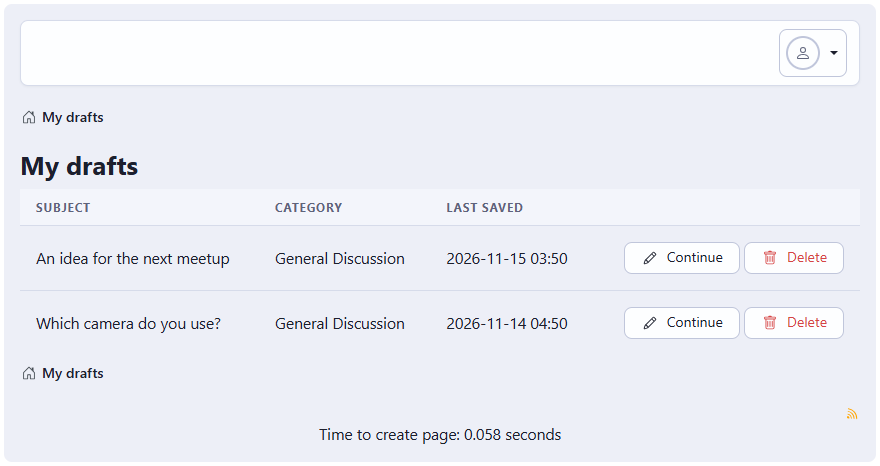

# Drafts

> **Label:** `feature` · **Since:** Kunena 8.0 · **For:** Users

Save a topic, a reply or an edit as a draft and finish it later.

A registered user can keep a message unfinished. The editor, the quick reply and the edit form get a **Save draft** button next to
Submit. The drafts are listed on a **My Drafts** page, with a button to continue and one to delete each draft.

## How it looks

*The editor of a new topic: Submit, Save draft and Cancel.*

*My Drafts: the title of a draft links to the topic it belongs to; Continue puts the text back in the editor.*

## How it works

- Drafts are stored for the user (at most 50 for each user). Posting the message, or saving the edit, removes its draft.
- **Continue** opens the editor with the saved subject, text and fields.
- The page is reached from the link in the profile box, or from a menu item of the type **My Drafts**.
- A guest is sent to the login. When the feature is off the page answers with a 404.

## Options

| Option | Where | Default |
| --- | --- | --- |
| Enable Drafts | Kunena configuration, *Posting and editing* › *Writing* | No |

## Recovering an unsent text in the browser

The template option **Recover crash and store fields** (`formRecover`, off by default) is a different, smaller safety net. It keeps
what is written in the posting form in the storage of the browser, and puts it back when the form is opened again after a crash,
a closed tab or a lost connection.

- **What is kept:** the subject, the text in CKEditor 5 or SCEditor, and the other fields, half a second after a change and every
  five seconds. Hidden fields, such as the token of the form, are never kept.
- **When it is removed:** when the form is sent or reset.
- **Where it is kept:** only in that browser, on that device, for that page. Nothing goes to the server, unlike a draft.
- **The code:** Kunena's own `media/kunena/core/js/form-recover.js` (`window.KunenaFormRecover`), in place of the Sisyphus library.
  It uses the same keys, so a text kept before an update of Kunena is still recovered after it.

---

[← All the new features of Kunena 8.0](../README.md)
