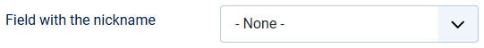

# Three names for a user: username, real name and nickname

> **Label:** `feature` · **Since:** Kunena 8.0 · **For:** Administrators, users

Show the username, the real name or a nickname, and let users choose.

The option *Name of a user* is now a choice of **Username**, **Real name** or **Nickname** (the old Yes/No values keep their meaning).

## How it works

- The nickname is a field of the Joomla users (Users, Fields). Choose that field in the configuration; a field which is unpublished or
  deleted is ignored. Make the field editable by the users in the profile.
- When the chosen name is empty the next one is shown (nickname, real name, username).
- With **Users choose their name** the users choose in their forum settings which of their names the others see.
- The names are used everywhere (also in the mention list). The user list, the user search, the mentions and the search of the
  messages of a user find a user by the name which the forum shows of him only: a name which it keeps for itself (the username
  when it shows the real names, the real name of a user who shows his nickname) would tell which member has that name.

## Options

| Option | Where | Default |
| --- | --- | --- |
| Field with the nickname | Kunena configuration, *Users and profiles* › *Names* | none |
| Users choose their name | same tab | No |

---

[← All the new features of Kunena 8.0](../README.md)
